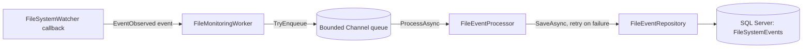

# File Monitoring Service

A .NET 10 **Worker Service** that watches one or more folders, detects when files are **created, changed, renamed or deleted**, and stores each event in a SQL Server database so the activity history can be inspected later.

> SIWES internship project. Author: Liadi Abdul-Malik | Supervisor: **[Supervisor Name]** | Submission date: 17/11/2026

---

## Features

- Monitors several folders from configuration, optionally including sub-folders.
- Detects **Created**, **Changed**, **Deleted** and **Renamed** events (a rename keeps both the old and the new path).
- Saves every event to the `FileSystemEvents` table with a UTC timestamp.
- Slow database work never runs inside the watcher callback: events go through a bounded queue (`Channel<T>`).
- Ignores repeated `Changed` events for the same file inside a short time window.
- Retries a failed database save (up to 3 attempts, waiting longer each time) and never crashes because of one failed save.
- Structured logging with `Microsoft.Extensions.Logging`.
- Validates its settings when it starts and prints every problem found.
- Shuts down safely: the watchers are disposed and the events still in the queue are saved (up to 5 seconds).
- 15 automated tests with xUnit.

## How it works



1. `DirectoryMonitor` owns one `FileSystemWatcher` per valid folder and turns each file callback into a `FileSystemEventRecord`.
2. It raises a C# event, `EventObserved`. The worker's event handler puts the record into the queue with `TryEnqueue`, which is instant.
3. `FileEventProcessor` reads the queue in a background loop, ignores repeated `Changed` events, and calls the repository.
4. `FileEventRepository` saves the record with Entity Framework Core.

## Project structure

```
(repository folder)
|-- FileMonitoringService.sln              (or .slnx)
|-- README.md
|-- Database/
|   `-- 001_CreateFileSystemEvents.sql
|-- FileMonitoringService/                 the Worker Service project
|   |-- Program.cs                         setup and dependency injection
|   |-- appsettings.json                   settings (placeholder values only)
|   |-- Options/                           FileMonitoringOptions and its validator
|   |-- Models/                            FileSystemEventRecord, FileEventType
|   |-- Monitoring/                        IDirectoryMonitor, DirectoryMonitor
|   |-- Services/                          IFileEventProcessor, FileEventProcessor
|   |-- Data/                              IFileEventRepository, FileEventRepository, MonitoringDbContext
|   `-- Worker/                            FileMonitoringWorker (start and stop of the service)
`-- FileMonitoringService.Tests/           xUnit tests
```

## Prerequisites

- [.NET 10 SDK](https://dotnet.microsoft.com/download/dotnet/10.0)
- Visual Studio 2026 (needed to build .NET 10 projects inside Visual Studio) or Visual Studio Code with the C# Dev Kit
- SQL Server LocalDB (installed with the Visual Studio "Data storage and processing" workload) or SQL Server Express
- Git

## Getting started

### 1. Clone the repository

```bash
git clone https://github.com/<your-username>/FileMonitoringService.git
cd FileMonitoringService
```

### 2. Create the database

Run the script in the `Database` folder. In Visual Studio: open **View > SQL Server Object Explorer**, right-click `(localdb)\MSSQLLocalDB`, choose **New Query...**, paste the contents of `001_CreateFileSystemEvents.sql` and press **Execute**. Or from a terminal:

```bash
sqlcmd -S "(localdb)\MSSQLLocalDB" -i Database\001_CreateFileSystemEvents.sql
```

The script is safe to run more than once.

### 3. Create the folders to monitor

```bash
mkdir C:\MonitoredFolders\Incoming
mkdir C:\MonitoredFolders\Reports
```

### 4. Check the configuration

Open `FileMonitoringService/appsettings.json` and check the folder paths and the connection string (see the reference below). The connection string uses Windows authentication, so no password is stored. For another server, put the real connection string in an environment variable instead of the file:

```bash
set ConnectionStrings__MonitoringDb=<your connection string>
```

### 5. Run the service

In Visual Studio, press **Ctrl + F5**. Or from a terminal:

```bash
dotnet run --project FileMonitoringService
```

You should see log lines such as `Monitoring C:\MonitoredFolders\Incoming ...`. Create, edit, rename or delete a file in a monitored folder and watch `Stored Created event for ...` appear. Stop the service with **Ctrl + C**.

### 6. Run the automated tests

```bash
dotnet test
```

or open **Test > Test Explorer** in Visual Studio and click **Run All Tests**.

## Configuration reference

| Setting | Default | Description |
|---|---|---|
| `ConnectionStrings:MonitoringDb` | LocalDB sample | SQL Server connection string. Required. |
| `FileMonitoring:Directories` | (required) | List of **full** folder paths to watch. |
| `FileMonitoring:IncludeSubdirectories` | `true` | Also watch sub-folders. |
| `FileMonitoring:Filter` | `*.*` | File filter, for example `*.pdf`. |
| `FileMonitoring:InternalBufferSizeKb` | `64` | Watcher buffer size (4 to 1024). Bigger = fewer lost events. |
| `FileMonitoring:ChannelCapacity` | `1000` | Maximum number of events waiting in the queue. |
| `FileMonitoring:DuplicateWindowMs` | `500` | `Changed` events for one file inside this window are saved once. |
| `FileMonitoring:MaxSaveAttempts` | `3` | Attempts to save one event before giving up. |
| `FileMonitoring:RetryBaseDelayMs` | `1000` | Wait before the 2nd attempt. It doubles after each failure. |

If a setting is invalid, the service **refuses to start** and lists every problem, for example:
`FileMonitoring:Directories[0] must be a full path, but was 'Reports'.`

## Database

Table `dbo.FileSystemEvents`:

| Column | Type | Purpose |
|---|---|---|
| `Id` | bigint identity | Primary key |
| `EventType` | nvarchar(30) | Created, Changed, Deleted or Renamed |
| `FileName` | nvarchar(260) | Name of the affected file |
| `FullPath` | nvarchar(1024) | Full path seen by the watcher |
| `OldFullPath` | nvarchar(1024), null | Previous path (Renamed events only) |
| `DirectoryPath` | nvarchar(1024) | The monitored directory |
| `OccurredAtUtc` | datetime2 | When the event was observed (UTC) |
| `ErrorMessage` | nvarchar(1000), null | Set when a save needed a retry |

Changes to the suggested design: `Id` is a bigint, a CHECK constraint limits `EventType` to the four allowed values, and there is an index on `OccurredAtUtc`. Only metadata is stored, never file contents.

Useful query:

```sql
SELECT TOP 50 * FROM dbo.FileSystemEvents ORDER BY OccurredAtUtc DESC;
```

## Tests

### Automated tests (xUnit)

| Test class | What it checks |
|---|---|
| `FileEventProcessorTests` (8) | An event is saved; close `Changed` events are saved once; distant `Changed` events are both saved; `Created` events are never ignored; a failed save is retried and the error is recorded; the service survives a database that always fails; the queue refuses events when full and after shutdown starts. |
| `FileMonitoringOptionsValidatorTests` (4) | An empty list, a blank path and a relative path are rejected; valid settings pass. |
| `DirectoryMonitorTests` (3) | Start fails when no folder exists; Start continues when one folder exists; a real file creates a `Created` event. |

**Result:** [15] tests run, [15] passed, [0] failed.

### Manual test scenarios

| # | Test | Action | Expected result | Result |
|---|---|---|---|---|
| 1 | File created | Create a text file in a watched folder | A `Created` event is saved | [Pass/Fail and a note] |
| 2 | File changed | Edit and save an existing file | A `Changed` event is saved | [Pass/Fail and a note] |
| 3 | File deleted | Delete a file | A `Deleted` event is saved | [Pass/Fail and a note] |
| 4 | File renamed | Rename a file | A `Renamed` event with old and new paths | [Pass/Fail and a note] |
| 5 | Subdirectories | Create a file inside a nested folder | An event is saved (recursive monitoring on) | [Pass/Fail and a note] |
| 6 | Invalid path | Add a folder that does not exist to `Directories` | A clear error is logged and the valid folders keep working | [Pass/Fail and a note] |
| 7 | Database unavailable | Take the database offline, then create a file | Retries and an error are logged; the service keeps running | [Pass/Fail and a note] |
| 8 | Shutdown | Press Ctrl + C | Watchers are disposed, the queue is saved, the service stops cleanly | [Pass/Fail and a note] |

Screenshots of these runs are in the `Screenshots` folder. [Delete this line if you do not add one.]

## Design note

**Structure.** Each class has one job: `DirectoryMonitor` watches folders, `FileEventProcessor` queues, filters and saves events, `FileEventRepository` talks to the database, `FileMonitoringWorker` controls the start and stop of the service, and `Program.cs` only connects them. Classes depend on interfaces, so the processor can be tested with a fake repository and no real database or folder.

**Policies.**
- **Missing or inaccessible folder:** the error is logged and that folder is skipped. The other folders keep being monitored. If no folder is valid, the service logs a critical error and stops.
- **Database failure:** up to `MaxSaveAttempts` attempts, waiting 1 second, then 2, then 4. If all fail, the error and the event details are logged and the service moves on to the next event. It never terminates because of one failed save.
- **Duplicates:** repeated `Changed` events for the same file inside `DuplicateWindowMs` are saved once. `Created`, `Deleted` and `Renamed` are never ignored.
- **Files in use:** the service never opens the monitored files, so a file that is still being written cannot cause an error.
- **Shutdown:** a cancellation token stops the processing loop. The worker then stops listening, disposes every watcher, and gives the processor up to 5 seconds to save the events still in the queue.

## Known limitations

- `FileSystemWatcher` can lose events if its buffer overflows. This is logged, but lost events cannot be recovered.
- An event that fails every save attempt is recorded in the log only, not in the database.
- Events waiting in the in-memory queue are lost if the process crashes. A normal shutdown saves them.
- If a watched folder becomes unavailable, its watcher may stop and the service must be restarted.
- Only file activity is recorded. Creating or renaming a folder itself is not.
- The service runs as a console application. Running it as a Windows Service is a possible improvement.

## Troubleshooting

| Problem | Likely cause and fix |
|---|---|
| The service stops straight away with `FileMonitoring:Directories must contain...` | The settings check failed. Fix `appsettings.json`. |
| `None of the configured directories could be monitored` | No configured folder exists. Create the folders or fix the paths. |
| `Cannot open database "FileMonitoringDb"` | Run the SQL script first, and check the connection string. |
| Many `Retrying` warnings | SQL Server is not running, or the database is offline. |
| `Watcher buffer overflow` | Increase `InternalBufferSizeKb` or reduce the file activity. |

## Possible improvements

An ASP.NET Core API to query the history, include and exclude file patterns, a health check, running as a Windows Service, and replaying events that could not be saved.
